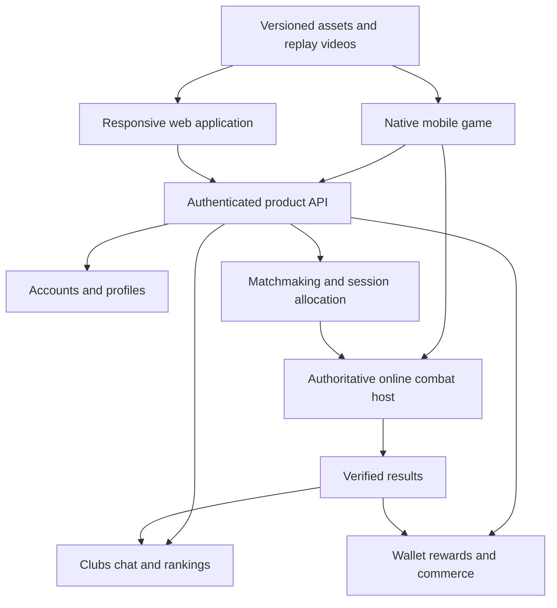

# Mobile and web platform structure

Prepared 6 October 2026. Confirmed delivery: native mobile boxing game plus responsive web companion. Android/iOS launch order and engine version remain open. This document replaces the earlier assumption that Windows must be the public launch platform. Windows can remain a development/test host without being a promised release.

## Recommended product arrangement

Use a native mobile boxing game plus a responsive web companion, connected to one backend. The user confirmed this arrangement on 6 October 2026. The mobile app provides playable fights and AI Watch mode; the web companion provides accounts, fighter information, clubs, rankings and permitted replay videos. Playable browser fights are outside the confirmed initial scope.

If playable browser fights are required, choose a full web game route explicitly before committing to the engine. A companion website, a browser-rendered game and a streamed game are different delivery architectures.

## Delivery options

| Option | Where combat/rendering run | Offline AI fights | Key tradeoff | Fit |
|---|---|---|---|---|
| Native mobile | Installed Android/iOS engine build on the device | Yes, with required assets downloaded and local entitlement defined | Device performance, battery, heat and touch controls constrain content | Recommended gameplay route when offline mobile is important |
| Web companion | Browser runs account/community UI; video player shows exported highlights | No local fight simulation | Does not deliver playable fights by itself | Recommended supporting application |
| Full browser game | Web-compatible game runtime on the user's device | Potentially, only after explicit caching/storage design and testing | Browser/device limits, downloads, input/audio behavior and persistence need testing | Evaluate if fighting directly in the browser is essential |
| Cloud-streamed game | Remote GPU runs combat/presentation; browser sends input and receives audio/video | No disconnected play | Connectivity, control latency, video quality and GPU operating cost | Evaluate if remote visual quality is more important than disconnected play |

Epic documents device-dependent mobile rendering paths and optimization requirements. A high-end desktop presentation cannot be assumed to fit every phone. [Epic mobile rendering](https://dev.epicgames.com/documentation/unreal-engine/mobile-rendering-features-in-unreal-engine), [mobile optimization](https://dev.epicgames.com/documentation/unreal-engine/performance-and-optimization-for-mobile-in-unreal-engine?lang=en-US)

Unity documents both native mobile and web platform requirements, making it a candidate when both native mobile and locally rendered browser combat are mandatory. Platform support is not proof that this game's target quality/performance is achievable. Pin and test a specific version. [Unity 6.0 system requirements](https://docs.unity3d.com/6000.0/Documentation/Manual/system-requirements.html)

Epic Pixel Streaming runs an Unreal application remotely and sends interactive audio/video to browsers. It adds cloud rendering infrastructure; it is not a local browser export or an offline mobile solution. [Pixel Streaming](https://dev.epicgames.com/documentation/en-us/unreal-engine/pixel-streaming-in-unreal-engine)

WebGPU can render complex browser graphics, but compatibility must be checked across the selected browsers/devices; MDN currently marks the API as limited availability. Do not make WebGPU the only path without a verified support matrix. [MDN WebGPU](https://developer.mozilla.org/en-US/docs/Web/API/WebGPU_API)

## Shared architecture



For the full-browser game option, add the web combat client to the combat host connection. For cloud streaming, add session allocation, remote render workers, WebRTC signaling and required connectivity infrastructure; remote rendering and result/wallet authority remain distinct responsibilities.

Start backend domains as modules in one deployable service where practical; a box in the diagram does not require a separate microservice. The combat host is a separate real-time runtime. Let measured scaling and operations needs justify further service splits.

## Feature ownership for the recommended arrangement

| Feature | Native mobile app | Web companion | Source of truth |
|---|---|---|---|
| Offline AI Fight | Full local gameplay | Information/download links | Local combat state; local rewards separated from online wallet |
| Online human Fight | Full gameplay | Invitation management/deep links | Combat server and verified result |
| AI Watch | In-engine camera/replay | Exported video highlights where available | Original recorded event/replay |
| Academy | Demonstrations and interactive drills | Reviewed lesson text/videos | Versioned lesson content |
| Fighter research/selection | Game-ready fighter selection | Published, approved fighter information | Versioned fighter catalog |
| Profile and rankings | Supported | Supported | Backend |
| Clubs and text chat | Supported | Supported | Backend membership/moderation state |
| Wallet and reward history | Supported | Supported | Authoritative transaction ledger |
| Coin purchases | Platform-appropriate payment adapter | Optional separately evaluated web shop | Verified receipts and backend ledger |
| Settings | Touch/controller/graphics settings | Browser/UI settings | Device-local settings plus selected account preferences |
| Support and privacy controls | Supported | Supported | Backend request/audit records |

A replay video is not an interactive 3D replay: it cannot provide arbitrary orbit cameras or inspect every simulation state. Native interactive replays need compatible content/build versions. Do not promise interactive browser replays until the browser runtime is selected.

## Shared and platform-specific components

Share data contracts, IDs, fighter/technique definitions, rules, reward policy, event schemas, localization keys and API specifications. Share combat implementation between supported builds of the selected engine where feasible. One wallet/account means one ledger, not balances copied between two clients.

Keep input bindings, UI layouts, rendering profiles, storage, notifications, authentication callbacks and purchase adapters platform-specific. A responsive HTML site is not the native boxing game. React/other web UI frameworks may implement the companion; they do not replace the 3D combat engine.

Use HTTPS APIs for ordinary product requests and a suitable authenticated real-time channel for chat/presence. Combat transport is an engine/network design decision validated with the prototype, not an assumption that all game traffic goes through a REST API. Clients never submit trusted balances, final winners or leaderboard positions.

## Proposed repository organization

This is a future layout, not code already generated. Place existing Markdown documents under docs only when references can be updated consistently.

```text
docs/
  product/
  research/
  architecture/
game/
  combat/
  presentation/
  content/
  platforms/android/
  platforms/ios/
  platforms/web/          # only if locally rendered web combat is selected
web/
  account/
  fighters/
  clubs/
  rankings/
  media/
  support/
backend/
  accounts/
  profiles/
  clubs/
  matchmaking/
  rewards/
  wallet/
  commerce/
combat-server/
contracts/
  api/
  combat-events/
  content-schemas/
tools/
  content-validation/
  fighter-annotation/
infrastructure/
  environments/
  monitoring/
```

Adapt the game subtree to the selected engine's normal project layout rather than force an artificial generic layout onto Unreal or Unity. Engine assets use appropriate binary version control/storage; contracts and ordinary code use conventional source control. Separate development, staging and production configuration.

## Navigation and device behavior

Mobile gameplay runs in landscape as a proposed default; test thumb reach, safe areas, touch occlusion and optional controller support. Organize the home screen around Offline, Online, Academy, Watch, Clubs and Profile, with Shop available only when the commerce feature is approved for delivery. Decide which menu screens rotate independently.

Web navigation: Home, Fighters, Academy, Rankings, Clubs, Profile, Media and Support; add Play only when browser combat is selected. Adapt menus to phone and desktop widths. Invitations link to a specific verified match offer, display exact stakes and open the installed game through tested links; accepting an invitation never silently debits a wallet.

On phone interruption/backgrounding, explicitly pause supported offline sessions and apply the disclosed reconnect rules online. Browser tab suspension follows the same online result policy; it must not grant refunds automatically. Cached profiles/clubs show last refresh state and cannot claim current presence or issue rewards offline.

## Device and performance gates

- Select actual Android/iOS test devices and supported OS/device classes before creating expensive assets. Android-first is a sequencing candidate, not yet a confirmed release choice; iOS requires its own build/signing/test setup.
- Measure a complete bout over a sustained session for frame times, memory, heat, battery, asset loading and input response. Proposed 60 FPS gameplay is a target for the chosen tier, not a guarantee for all phones.
- Test touch movement, head/body targeting and defense with beginners. Desktop controller controls cannot simply be copied into small touchscreen buttons.
- Produce platform content profiles: lower-cost crowd, lighting, materials, textures and animation updates while preserving authoritative contact timing and fighter readability.
- For browser combat, test selected Safari/Chrome/Firefox/Edge and phone browsers as applicable, along with memory, download size, startup time, audio activation, gamepad/touch, context loss and storage eviction.
- For streaming, measure end-to-end input-to-video latency, bitrate/image quality, disconnects, concurrent GPU capacity, cost per player-hour and availability in the target regions. Offline play remains a separate native path if required.
- Cross-platform online play is a separate product decision requiring compatible rules/content and fair input policies; shared accounts alone do not imply cross-play.

## Implementation sequence and decision status

1. Apply the confirmed native-mobile/game and web-companion split. Preserve the existing offline AI requirement through local mobile simulation and downloaded assets.
2. Select first mobile OS/device tier and benchmark native combat. If full web gameplay is required, benchmark browser combat or streaming alongside the native candidate before fixing the engine.
3. Define one backend/API contract and a minimum shared profile/content model; do not build parallel mobile/web wallet implementations.
4. Build the combat proof and a small companion shell as separate deliverables. Select the UI stack through a normal implementation evaluation rather than assume game engine code is reusable web UI.
5. Deliver the live-event slice on the selected gameplay platform, then grow verified online/community services and the other selected clients.

Pending choices: mobile OS launch order, target device tier, evaluated engine/version and cross-platform Android/iOS match policy. Browser combat and cloud streaming are documented alternatives for future scope changes, not active implementation requirements. Use the confirmed split for subsequent specifications and reversible implementation work; deployments and purchases follow their applicable authorization requirements.
